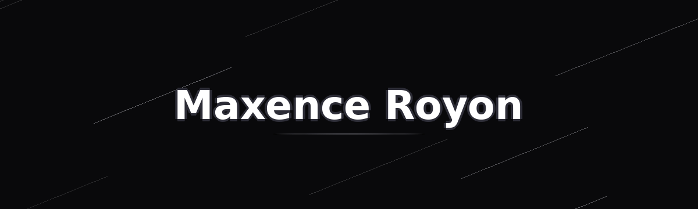

  

<h1 align="center">Salut, je suis Maxence ! 👋</h1>

  Étudiant en 2ᵉ année de <b>BUT Informatique</b> à l'IUT de Lens · Développement web & application

---

J'aime autant que le code tourne bien que l'interface soit belle à regarder — construire des choses qui servent vraiment à quelqu'un, voilà ce qui me motive.

### 🔍 Je recherche actuellement

- un **stage** pour **avril 2027** (8 à 10 semaines)
- une **alternance** pour **septembre 2027**, sur Lille, Lens, Arras et alentours

## 🛠️ Compétences techniques

**Front-end**

  

**Back-end & logiciel**

  

**Bases de données**

  

**Outils**

  

## 🎓 Formation

- **BUT Informatique**, 2ᵉ année — IUT de Lens (depuis 2025)
- **Baccalauréat Informatique**, spécialité Systèmes d'Information et Numérique (SIN) — Lycée Albert Châtelet (2024–2025)

## 💼 Expériences

- **Employé polyvalent** — Au Verger des 7 Vallées, Blangy-sur-Ternoise (avr.–juil. 2026) : caisse, mise en rayon, relation client
- **Membre du Bureau des Étudiants (BDE)** — IUT Lens (depuis 2025) : organisation d'événements pour les étudiants du département

## 🎯 Objectifs

- Continuer à progresser en développement full-stack et découvrir de nouvelles architectures
- Rejoindre une équipe où construire des choses concrètes, utiles, et apprendre sur le terrain
